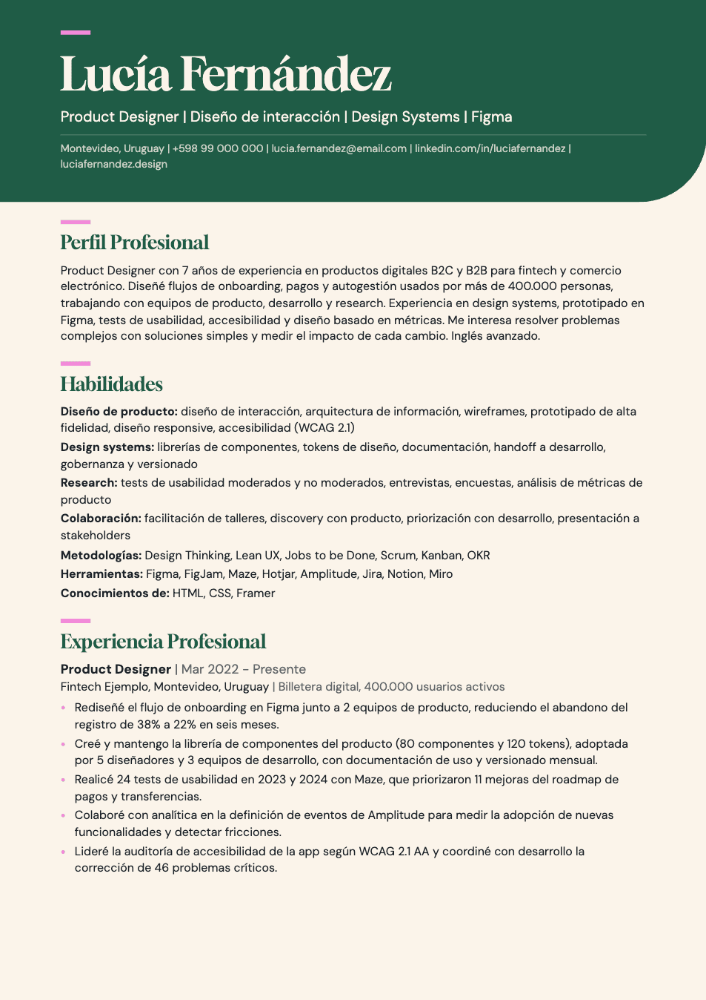
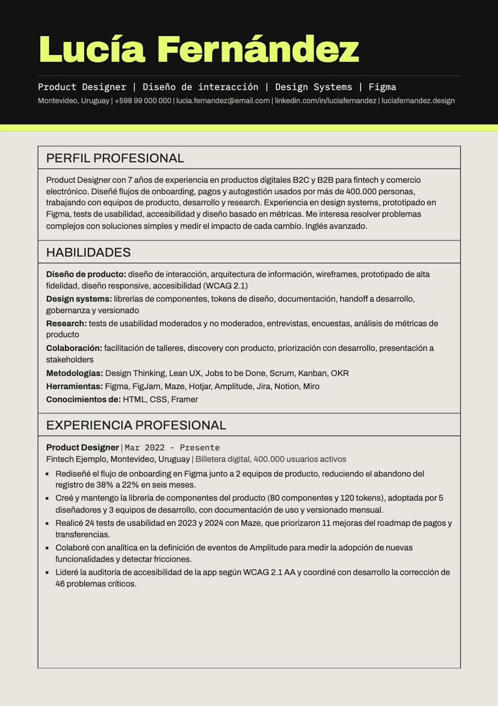
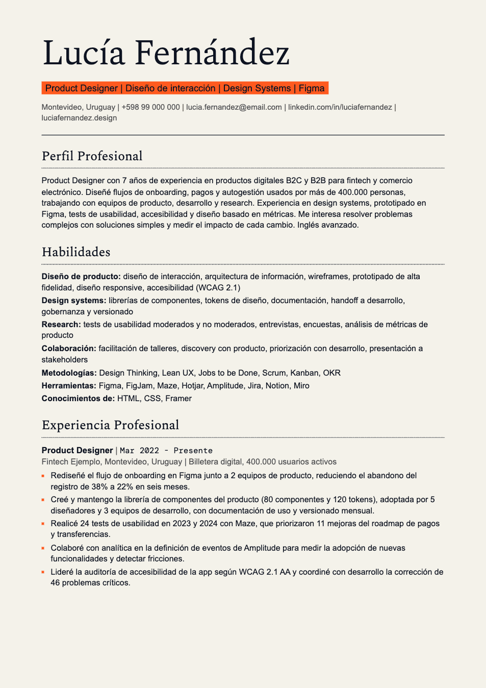
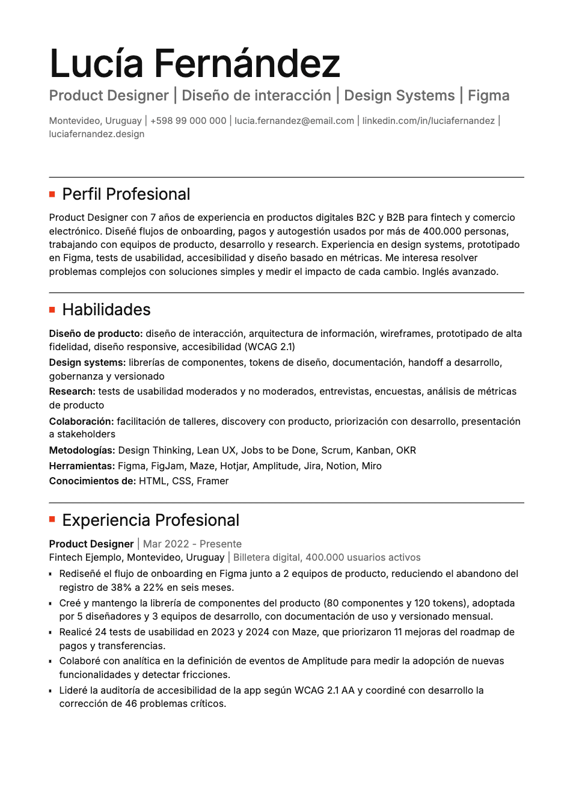
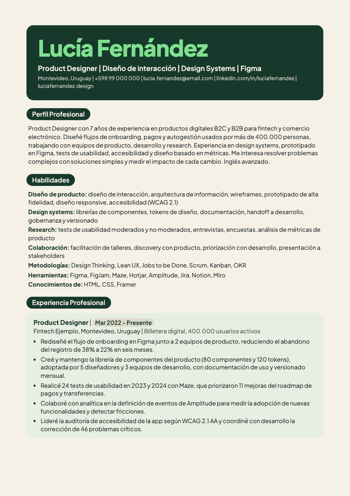
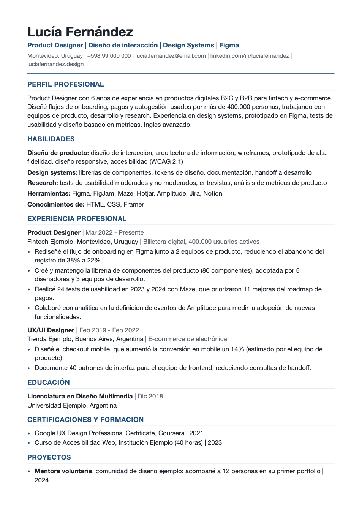

# Kit CV ATS

Dos skills gratuitos para que cualquier persona de IT arme su perfil profesional una vez y después genere CVs adaptados a cada oferta, pensados para pasar filtros ATS y sin inventar nada.

Funciona en Claude, Gemini, ChatGPT y en agentes como Claude Code, Codex, Gemini CLI o Cursor. Si tu herramienta no acepta skills, también hay una versión para copiar y pegar.

Creado por [Mauro Berteri](https://mauroberteri.com). Guía completa en [mauroberteri.com/recursos/kit-cv-ats](https://mauroberteri.com/recursos/kit-cv-ats).

## Cómo funciona

1. **`perfil-profesional-ats`** te entrevista, una pregunta por vez, y arma tu `perfil-profesional.md`: un archivo con toda tu experiencia, logros con cifras, herramientas con nivel real y lo que nunca se puede afirmar. Lo haces una vez y lo actualizas cuando cambia algo.
2. **`generador-cv-ats`** lee tu perfil y la oferta que le pegues, te dice con honestidad qué tan bien encajas, y genera un CV en HTML listo para guardar como PDF.
3. Validas el PDF en [Jobscan](https://www.jobscan.co) y, si quieres subir el puntaje, le pegas el resultado al generador.

Un aviso honesto: Jobscan mide coincidencia de palabras clave, no garantiza que pases un ATS ni que te llamen. El kit apunta a maximizar ese match sin mentir. Un 85% verdadero vale más que un 95% que se cae en la entrevista.

## Instalación

| Si usas | Haz esto |
|---|---|
| **Claude** (web o app) | Descarga [perfil-profesional-ats.zip](https://github.com/maurobert0/kit-cv-ats/releases/latest/download/perfil-profesional-ats.zip) y [generador-cv-ats.zip](https://github.com/maurobert0/kit-cv-ats/releases/latest/download/generador-cv-ats.zip). En Claude ve a Customize > Skills > + > Create skill > Upload a skill y sube cada zip sin descomprimir. Necesitas tener activado "Code execution and file creation" en Settings > Capabilities. |
| **Gemini** (web o app) | Descarga [perfil-profesional-ats.zip](https://github.com/maurobert0/kit-cv-ats/releases/latest/download/perfil-profesional-ats.zip) y [generador-cv-ats.zip](https://github.com/maurobert0/kit-cv-ats/releases/latest/download/generador-cv-ats.zip). En Gemini ve a Settings > skills > Upload y sube cada uno. Requiere cuenta personal, ser mayor de 18 y tener activada la actividad de Gemini. |
| **ChatGPT** | Descarga [perfil-profesional-ats.zip](https://github.com/maurobert0/kit-cv-ats/releases/latest/download/perfil-profesional-ats.zip) y [generador-cv-ats.zip](https://github.com/maurobert0/kit-cv-ats/releases/latest/download/generador-cv-ats.zip) y súbelos en la sección Skills, si tu plan la tiene. |
| **Agentes de código** (Claude Code, Codex, Gemini CLI, Cursor, Copilot y otros) | `npx skills add maurobert0/kit-cv-ats` |
| **Cualquier otro chat** | Abre [`prompts/01-perfil-profesional.md`](prompts/01-perfil-profesional.md), copia desde "INICIO DEL PROMPT" y pégalo en una conversación nueva. Cuando tengas tu perfil, haz lo mismo con [`prompts/02-generador-cv.md`](prompts/02-generador-cv.md). |

## Uso

1. En un chat nuevo: "Quiero armar mi perfil profesional." Comparte tu CV o tu LinkedIn en PDF si los tienes.
2. Guarda el `perfil-profesional.md` que te entrega. Si tu app tiene Proyectos, guárdalo ahí.
3. Para cada oferta, en un chat nuevo: "Hazme un CV para esta oferta" y pega el texto completo.
4. Abre el HTML en Chrome o Edge, imprime y elige "Guardar como PDF".

## Privacidad

Este repositorio no guarda datos de nadie. Tu perfil vive en tu computadora y en la cuenta de la IA que uses. No compartas información confidencial de tus empleadores.

Antes de instalar cualquier skill, incluido este, puedes leer sus archivos `SKILL.md`: son texto plano.

## Templates

Los seis comparten la misma estructura y cambian solo la piel. `clasico` es el que se usa si no eliges otro.

| | | |
|---|---|---|
|  |  |  |
| **editorial.** Cálido y editorial, con papel crema, encabezado verde y nombre en serif. | **grotesk.** Alto contraste, con encabezado negro, franja lima y secciones enmarcadas. | **analitico.** Informe de datos, con papel marfil y titular resaltado en naranja. |
|  |  |  |
| **suizo.** Blanco y negro, con el nombre y el titular en dos tonos y un cuadrado rojo junto a cada título. | **cercano.** Amable y redondeado, con bloque verde bosque, nombre en menta y títulos en píldora. | **clasico.** Sobrio y universal, con azul y títulos en mayúscula. Es el estilo por defecto. |

## Estructura

```
skills/
  perfil-profesional-ats/   Entrevista y plantilla del perfil
  generador-cv-ats/         Reglas ATS, redacción, templates y script opcional
prompts/                    Versión copiar y pegar de los dos skills (se genera con tools/generar_prompts.py)
```

## Licencia

Código y templates bajo [MIT](LICENSE). Textos e instrucciones bajo [CC BY 4.0](LICENSE-CONTENT.md): puedes usarlos y adaptarlos mencionando la fuente.
